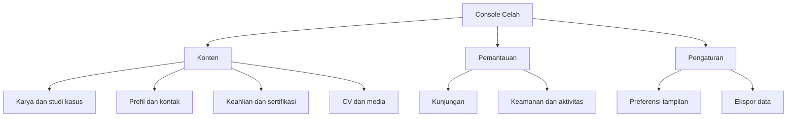

# Riset redesign auth dan admin — Celah

> Implementasi lokal hasil riset ini sekarang tersedia; lihat [catatan implementasi 17 November](../AUTH_ADMIN_REDESIGN_IMPLEMENTATION.md). Pernyataan “belum diimplementasikan” di bawah menjelaskan status saat laporan riset ditulis, bukan status working tree setelah implementasi. Bukti riset tetap bertanggal 15 November.

Riset dan capture browser: **15 November 2026**. Pemeriksaan akhir laporan: **17 November 2026**, pada HEAD yang masih sama. Codebase: **`c6aa304`** (`feat(console): elevate /auth and /admin with architectural Celah Console system and purge AI slop`). Arah pilihan pemilik: **Celah yang lebih matang dan konsisten**.

Ringkasan keputusan dan scope implementasi tersedia dalam [brief redesign](AUTH_ADMIN_REDESIGN_BRIEF.md). Tanggal sumber dan bukti browser tetap mengikuti pengambilan awal; keduanya tidak diklaim diperbarui pada pemeriksaan akhir.

## 1. Rekomendasi utama

Pertahankan identitas Celah, lalu bangun **halaman akses yang tenang dan ruang kerja editorial yang jelas**. Gunakan petrol–ivory, champagne/bronze, TembusMark, Space Grotesk dan detail seam yang terkendali. Pusat perhatian admin adalah pekerjaan konten: memperbarui proyek, studi kasus, CV, profil dan sertifikasi; pemantauan menjadi tujuan terpisah.

Redesign perlu mengubah susunan pekerjaan, perilaku form dan model feedback, selain tampilan. Revisi terbaru sudah mendekatkan warna console dengan situs publik, tetapi masih mewarisi alur lama dan menambahkan beberapa indikator keamanan yang tidak berasal dari pengukuran. Pekerjaan awal sebaiknya menangani keselamatan unggahan, pemilihan massal dan kebenaran notifikasi; tampilan baru tidak boleh menyembunyikan masalah tersebut.

**Hasil riset ini:** audit source, inspeksi browser lokal, perbandingan 16 sumber primer, arah visual, IA, spesifikasi interaksi dan rencana validasi. **Belum ada implementasi redesign, perubahan backend aplikasi, push atau deployment.** Skrip capture adalah alat riset dengan API fixture, bukan fitur aplikasi.

## 2. Metode, bukti dan batas kesimpulan

| Metode | Yang dilakukan | Yang tidak dibuktikan |
| --- | --- | --- |
| Audit source | Membaca auth, admin, panel turunannya, CSS console, portal, API client dan backend | Seluruh bug telah ditemukan atau source yang sama sedang live |
| Browser lokal | Chromium headless, source Vite pada commit di atas, light/dark desktop dan dark mobile, validasi kosong, dialog proyek | Browser production, Safari/iOS, screen reader, keyboard virtual fisik, performa perangkat |
| Fixture API | Session admin fiktif `researcher@example.invalid`, empat proyek kurasi dari source, panel lain kosong, CAPTCHA dinyatakan tidak aktif | Keberhasilan login, unggahan, email, penyimpanan atau hak akun sungguhan |
| Reproduksi terisolasi | EventSource tiruan membuktikan filter subscriber tidak menahan event login sukses | Pengiriman event production atau volume insiden nyata |
| Riset eksternal | Membaca dokumentasi primer W3C/WAI, OWASP, NIST, web.dev, GOV.UK, Carbon dan Atlassian | Wawancara pengguna, benchmark visual aplikasi referensi atau sertifikasi kepatuhan |

Tidak ada akses ke VPS, akun production, data privat atau pengiriman email dalam riset ini. Source tidak diubah untuk membuat screenshot. Semua request API pada sesi capture diintersep fixture; request eksternal diblokir. Screenshot memakai reduced motion, sehingga bukan bukti kualitas animasi.

Viewport yang benar-benar diperiksa: **1440×1000** untuk kedua tema; **390×844** dan **320×740** untuk dark mode. Tidak ada horizontal overflow halaman pada delapan kombinasi ini. Jumlah sampel dan fixture kecil: hasil tersebut tidak menjamin tabel besar, teks panjang atau zoom selalu aman.

### Artefak baseline

- [Auth dark, desktop](media/auth-admin-current/auth-dark-1440.png), [auth light](media/auth-admin-current/auth-light-1440.png), [auth 390 px](media/auth-admin-current/auth-dark-390.png), [auth 320 px](media/auth-admin-current/auth-dark-320.png).
- [Admin dark, desktop](media/auth-admin-current/admin-dark-1440.png), [admin light](media/auth-admin-current/admin-light-1440.png), [admin 390 px](media/auth-admin-current/admin-dark-390.png), [admin 320 px](media/auth-admin-current/admin-dark-320.png).
- [Dialog proyek pada console dark](media/auth-admin-current/admin-project-dialog-dark-1440.png), [validasi auth kosong](media/auth-admin-current/auth-invalid-dark-1440.png).
- [Hasil DOM, computed styles dan interaksi](media/auth-admin-current/browser-evidence.json).

Reproduksi dari root repository: jalankan Vite lokal pada port 8080, kemudian `node scripts/research/capture-auth-admin.cjs`. Skrip membutuhkan Playwright dan Chromium; dapat memakai `PLAYWRIGHT_MODULE`, `CHROME_PATH` dan `RESEARCH_BASE_URL`. Target dibatasi ke localhost. Skrip tidak menjalankan server aplikasi, mengubah kredensial atau menyimpan konten. Resolusi browser disesuaikan di dalam skrip, bukan hasil emulasi perangkat fisik.

## 3. Kondisi produk yang harus menentukan desain

Pengguna utama yang diinferensikan dari aplikasi adalah pemilik/pengelola portofolio. Belum ada penelitian frekuensi pekerjaan, jadi urutan berikut merupakan hipotesis untuk divalidasi bersama pemilik:

1. Memperbarui karya dan studi kasus, termasuk gambar, tautan dan featured.
2. Mengganti CV, bio, keahlian, sertifikasi serta informasi kontak.
3. Memeriksa kunjungan, aktivitas dan percobaan login ketika diperlukan.
4. Mengambil ekspor data atau menyesuaikan preferensi tampilan.

Aplikasi sudah mendukung cookie session, otorisasi admin di server, CRUD konten, unggahan, agregasi analytics dan SSE. Akun hasil signup **bukan otomatis admin**; verifikasi email dan pemulihan lewat email bergantung pada SMTP. Passkey, OAuth, MFA, undangan admin, draft server, revision history, autosave server dan penjadwalan rilis belum menjadi kemampuan yang dapat diasumsikan tersedia.

Penyimpanan CMS memperbarui data API. HTML/metadata SEO statis mengikuti build dan deployment berikutnya. Karena itu, label status harus membedakan perubahan lokal, data tersimpan dan versi situs yang sudah dirilis. Jangan menambahkan badge “Published”, “Synced” atau “Live” hanya berdasarkan klik tombol.

## 4. Temuan yang harus ditangani sebelum atau bersama redesign

Prioritas di tabel ini mengurutkan pekerjaan redesign, bukan rating kerentanan keamanan formal.

| Prioritas / temuan | Bukti dan dampak | Rekomendasi |
| --- | --- | --- |
| **Mendesak: penggantian cover dapat kehilangan gambar lama** | `Admin.tsx:446–472` menghapus objek lama lebih dahulu; kegagalan unggahan dikonversi menjadi null. `503–543` dapat tetap menyimpan proyek dan melaporkan sukses. UI menerima GIF (`385–389`, `1369–1391`), tetapi API menolaknya. Terverifikasi dari alur source; tidak diuji dengan media production. | Validasi format sesuai server; unggah objek baru dahulu, simpan referensi setelah berhasil, baru bersihkan objek lama. Kegagalan mempertahankan gambar lama, preview dan isian. Jangan laporkan sukses parsial sebagai sukses penuh. |
| **Mendesak: notifikasi login gagal bisa berisi login sukses** | `NotificationCenter.tsx:86–125` mengandalkan `filter: success=eq.false`; `api/client.ts:26–30` mengabaikan filter tersebut. Reproduksi EventSource terisolasi mengirim `success:true` ke subscriber gagal. | Filter sesuai kontrak event dan cek hasil sebelum menambah unread/alert. Status keamanan harus benar sebelum permukaannya didesain ulang. |
| **Tinggi: cakupan selection dan penghapusan tidak jelas** | `Admin.tsx:662–667`, `1092` membandingkan jumlah pilihan dengan jumlah baris halaman. Pilihan dari halaman/filter lain bisa membuat checkbox header keliru; penghapusan memakai seluruh ID terpilih. | Hitung irisan ID halaman; gunakan checked/indeterminate yang benar. Jelaskan jumlah terpilih dan pilihan di luar filter. Konfirmasi menyebut objek dan jumlah. |
| **Tinggi: kontras CTA light** | Browser menghasilkan foreground `rgb(244,241,236)` dan background `rgb(152,115,67)`: sekitar **3,8:1**, di bawah 4,5:1 untuk label kecil yang dipakai. Komentar hex CSS tidak sama dengan nilai HSL aktual. | Pilih pasangan warna yang terukur, uji default/hover/focus/disabled dan destructive. Jangan menyusun token dari komentar CSS. |
| **Tinggi: navigasi mobile kehilangan nama** | Pada 320/390 px, delapan tab mempunyai teks terlihat kosong dan tanpa `aria-label`; pencarian role tab bernama Projects menghasilkan nol. | Navigasi berlabel, baik drawer maupun daftar destination ringkas. Tooltip tidak menggantikan accessible name. |
| **Tinggi: form auth belum menghubungkan error ke field** | Browser memastikan `name`/`autocomplete` kosong, tanpa `aria-invalid`/`aria-describedby`. Setelah submit kosong, error muncul tetapi fokus tidak menuju field/summary. `PublicDesignBoundary.tsx:16` menghasilkan `lang=en` untuk UI Indonesia. | Semantic fields, autocomplete sesuai mode, error terhubung, fokus terarah, bahasa dokumen benar, status pengiriman tetap bernama. |
| **Tinggi: registrasi tidak menjelaskan provisioning** | `Auth.tsx:399–403` menjanjikan langkah login setelah daftar; `server/app.mjs:49` memerlukan verifikasi email dan `schema.sql:7` memakai `is_admin=false`. | Jadikan login jalur utama. Tentukan kebijakan pembuatan akun sebelum mempromosikan registrasi; jangan menjanjikan akses pengelolaan bagi akun baru. |
| **Menengah: portal keluar dari sistem visual** | Dialog browser memiliki background `rgb(12,14,18)` dan `withinConsole:false`, berbeda dari surface console. `PublicDesignBoundary.tsx:14` hanya memberi portal host pada halaman publik. | Console mempunyai scoped portal host untuk dialog, select, alert dan notification. Uji keduanya, bukan halaman dasarnya saja. |
| **Menengah: pagination dapat terjebak setelah penghapusan** | `Admin.tsx:241–250`, `1231` tidak meng-clamp halaman ketika jumlah data turun; kontrol dapat hilang saat tersisa satu halaman. | Pertahankan posisi valid setelah mutasi dan pulihkan konteks daftar saat kembali dari editor. |
| **Menengah: “Backup lengkap” sebenarnya ekspor parsial** | `DataExporter.tsx:68–75`, `108–134` membatasi 1.000 record, tidak mencakup semua konten/unggahan, serta dapat mengubah error menjadi array kosong. | Gunakan nama “Ekspor data” dengan cakupan, jumlah, kemungkinan terpotong dan kegagalan per resource. Backup pemulihan tetap database + unggahan + konfigurasi melalui operasi server. |
| **Menengah: state gagal, kosong dan belum tersimpan bercampur** | Kegagalan fetch proyek berakhir pada toast dan daftar kosong; modal/editor dapat kehilangan perubahan lokal. Header aksi proyek tetap tampil di tab lain; logout muncul dua kali. | Empty/error/no-results/stale-data dibedakan; save state dan dirty guard jelas; aksi mengikuti halaman, satu menu akun. |
| **Menengah: ThemeCustomizer berbenturan dengan scope baru** | `ThemeCustomizer.tsx:89–94` mengubah `:root`, console mendefinisikan token pada descendant. Preview bisa tidak mengubah console walau toast menyatakan perubahan. | Mulai dengan light/dark personal. Jika editor tema dipertahankan, tentukan target, scope, preview dan persistensi yang benar. |

### Temuan kontrak auth tambahan

- Precheck throttling menerima `identifier/action` legacy, tetapi backend hanya menghitung IP dan mengembalikan 900 detik tetap; login sebenarnya memeriksa IP **atau email** (`server/app.mjs:43`, `55`). Server tetap menegakkan batas; masalah yang ditemukan adalah feedback UI yang tidak selaras. Gunakan status/retry time dari respons server dan pertahankan pemeriksaan server.
- Hasil `.trim()` dari parsing Zod tidak dipakai untuk nilai yang dikirim. Ini risiko normalisasi source; native `type=email` dapat melakukan sanitasi sendiri, sehingga kegagalan end-to-end pada setiap browser belum dibuktikan. Tetapkan satu hasil parse yang digunakan untuk request; jangan memodifikasi isi password.
- Form reset dapat muncul dengan `reset=true` walau token tidak ada/malformed; token kedaluwarsa baru diketahui setelah submit. Rancang state link tidak valid, kedaluwarsa dan berhasil tanpa mengonsumsi token hanya untuk mengecek tampilan.
- Session-check failure saat ini mudah diperlakukan sebagai anonim; authenticated non-admin perlu layar akses ditolak yang jelas, bukan putaran redirect yang membingungkan. Navbar logout juga membutuhkan feedback bila request gagal.
- Field upload yang hanya berupa clickable div dan hidden input memerlukan kontrol keyboard nyata. Icon edit/delete, checkbox dan tombol logout mobile memerlukan nama yang menyebut tindakannya.

## 5. Pelajaran dari sumber primer

Riset ini membandingkan pola tugas, bukan menyalin screenshot atau library dari produk lain.

| Sumber | Pelajaran yang relevan | Penerapan pada Celah |
| --- | --- | --- |
| Carbon data table [S9] | Toolbar menampung search/filter/aksi; selection memiliki batch mode; aksi touch tetap dapat ditemukan | Satu toolbar daftar karya; batch scope jelas; aksi row tidak bergantung hover |
| GOV.UK tabs [S10] | Tabs bukan pola navigasi halaman dalam desain sistem tersebut | Tujuan utama admin mempunyai URL/konteks yang bisa dipulihkan; tab lokal hanya untuk bagian editor yang saling terkait |
| GOV.UK summary list [S11] | Fakta kunci dan review perlu berhubungan jelas dengan tindakan ubah | Ringkasan CV aktif, tautan publik, featured dan perubahan yang akan disimpan |
| GOV.UK buttons/error summary [S12–S13] | Label mengikuti perilaku; konfirmasi destruktif jelas; error terhubung dengan isian | “Simpan perubahan”, “Ganti CV”, “Hapus 3 proyek”; pertahankan input ketika gagal |
| GOV.UK notification/task list [S14–S15] | Informasi penting ditempatkan sesuai konteks; status bukan dekorasi atau tombol semu | Exception yang benar-benar perlu tindakan, bukan panel status hijau permanen |
| Atlassian inline message [S16] | Jelaskan masalah dan langkah berikut; sesudah membuat objek, beri jalan melihatnya | Feedback tersimpan + tautan relevan; kegagalan punya tindakan ulang yang aman |
| W3C/WAI [S1–S4] | Auth yang dapat dibantu password manager/paste, target/fokus/error yang memadai | Form yang dikenali browser, fokus terlihat, error yang dapat ditindaklanjuti |
| OWASP/NIST/web.dev [S5–S8] | Error auth menjaga anti-enumeration; autofill dan credential lifecycle adalah fungsi nyata | Tidak menambah passkey/MFA semu atau badge kepatuhan tanpa dukungan backend |

**Batas transfer:** aturan GOV.UK/Carbon merupakan panduan sistem mereka, bukan kewajiban otomatis untuk setiap detail Celah. Riset ini tidak menganggap semua tabel mobile harus berubah menjadi kartu atau setiap login harus memakai error summary besar. Pilihan di bawah adalah sintesis untuk skala portofolio ini.

## 6. Arah desain yang dibandingkan

| Arah | Kecocokan | Biaya dan risiko | Keputusan |
| --- | --- | --- | --- |
| Memoles kartu auth dan delapan tab sekarang | Menjaga perubahan kecil, dapat memperbaiki token dan label dengan cepat | Fragmentasi editor, konteks URL dan state lama tetap ada | Layak sebagai stabilisasi awal, tidak cukup sebagai redesign selesai |
| **Ruang kerja editorial Celah** | Identitas publik tetap dikenali; navigasi mengikuti pekerjaan, editor lebih tenang | Memerlukan shell, route/guard, portal dan state form yang terencana | **Rekomendasi utama** |
| Console operasi padat dengan telemetry dominan | Cocok bila produk berkembang menjadi pengelolaan banyak sistem | Kebutuhan saat ini belum membenarkan kompleksitas; berisiko menambah status fiktif | Tidak dipilih untuk cakupan sekarang |

Penilaian ini merupakan keputusan desain berbasis source dan skala produk, bukan hasil pengukuran preferensi pengguna.

### Bahasa visual yang dipertahankan

- Logo **TembusMark** asli; monogram “H” di header/auth tidak mempunyai hubungan yang terlihat dengan identitas situs.
- Petrol dan ivory sebagai landasan; champagne/bronze untuk tindakan utama; cyan untuk informasi/fokus yang memang membutuhkannya.
- Space Grotesk untuk heading, Inter untuk pekerjaan membaca/mengisi, JetBrains Mono hanya untuk ID, kode, waktu dan data teknis yang berguna.
- Garis halus dan sudut fungsional 4–8 px sebagai usulan awal; hindari override global `.rounded-full` dan `!important` untuk mengendalikan semua komponen sekaligus.
- Motif seam cukup pada brand panel atau detail pembatas. Form dan tabel tidak perlu menerima efek hero publik.
- Cursor dan scroll native pada area kerja sebagai default yang direkomendasikan. Motion singkat untuk feedback yang membantu, tanpa pulse status permanen; reduced motion tetap dihormati.

### Token kandidat, belum diterapkan

Rasio berikut dihitung memakai luminansi relatif sRGB untuk pasangan opak. Ini bahan spesifikasi awal, bukan hasil audit seluruh komponen; hover, opacity, overlay dan warna berdampingan tetap harus diuji.

| Peran | Foreground / background | Rasio perkiraan |
| --- | --- | --- |
| Aksi light | `#FFFFFF` / `#92400E` | 7,09:1 |
| Aksi dark | `#0B181C` / `#C7B594` | 9,01:1 |
| Teks light | `#14171A` / `#F8F6F1` | 16,66:1 |
| Teks dark | `#F1ECE1` / `#0B181C` | 15,35:1 |
| Error light | `#A12424` / `#FFFFFF` | 7,52:1 |
| Error dark | `#F3A49F` / `#112328` | 8,20:1 |
| Stroke input light | `#7A817C` / `#FFFFFF` | 3,99:1 |
| Stroke input dark | `#6C8588` / `#0B181C` | 4,60:1 |

Target desain awal: field 16 px, label/body 14–16 px, heading auth 28–32 px, heading halaman 24–32 px; spacing 4/8/12/16/24/32 px. Tombol utama dan kontrol mobile ditargetkan setidaknya 44 px tinggi. **WCAG 2.2 AA SC 2.5.8 memakai 24×24 px dengan pengecualian**, bukan 44 px; target 44 px di sini adalah keputusan kenyamanan internal. Tidak semua target 16–20 px yang ditemukan otomatis gagal karena spacing/equivalent target perlu diperiksa.

## 7. Rancangan pengalaman auth

### Komposisi

Desktop: header minimal dengan TembusMark/nama, kembali ke portofolio dan tema. Form sekitar 400–440 px, satu heading “Masuk ke pengelolaan portofolio”, deskripsi satu kalimat, label jelas dan satu tombol “Masuk”. Brand panel samping opsional dengan seam tipis; jangan menambah panel hanya untuk memenuhi ruang kosong. Mobile: satu kolom, gutter 20–24 px, lebar penuh yang aman untuk keyboard dan text scaling.

Ganti `AUTH_NODE // PRIVILEGED`, `TLS_1.3`, `SHA-256` dan `[LIVE]` yang hardcoded dengan bahasa tugas. Ini tidak menyatakan TLS production salah: source hanya tidak mengukur protokol/status yang ditampilkan. CAPTCHA yang tidak aktif cukup dijelaskan dengan kemampuan nyata, tidak perlu bay “integrity” yang terlihat seolah membuktikan hash/verifikasi.

### State dan kontrak

| State | Feedback / tindakan yang diperlukan |
| --- | --- |
| Mengecek sesi | Label “Memeriksa sesi…”; jika gagal, retry yang nyata, jangan otomatis dianggap anonim |
| Siap masuk | Email/password, autofill/paste, show/hide password, pemulihan yang jujur |
| Isian tidak valid | Pesan di dekat field dan terhubung secara programatis; fokus diarahkan setelah submit |
| Mengirim | Teks “Sedang masuk…” tetap ada, cegah double submit dan pergantian mode yang berlomba dengan request |
| Login ditolak | Pesan generik yang menjaga anti-enumeration; email tetap tersedia untuk koreksi |
| Terbatas percobaan | Waktu/tindakan mengikuti respons server; recovery yang sah tidak disembunyikan hanya lewat pointer-events |
| CAPTCHA loading/error/expired | Perbedaan state jelas; mekanisme retry tidak meniadakan verifikasi server |
| Email tidak tersedia | Jelaskan layanan belum tersedia; jangan berjanji email sudah terkirim |
| Akun sah, bukan admin | Penjelasan akses dan jalan kembali; tidak mempromosikan signup sebagai jalan menjadi admin |
| Link reset invalid/expired | State khusus, jalur pemulihan yang benar-benar tersedia, query token dibersihkan ketika keluar dari alur |
| Reset berhasil | Konfirmasi penggantian dan login kembali; session/token revocation tetap mengikuti backend |

Field email menggunakan nama stabil dan `autocomplete="username"`; password login `current-password`, password baru `new-password`. Show-password memakai `type="button"`, label/state aksesibel dan tidak menghapus nilai. Error menggunakan `aria-invalid`, ID/deskripsi stabil dan pengumuman yang sesuai. Pilihan fokus tidak boleh berpindah sewaktu pengguna sekadar mengetik.

**Kebijakan registrasi:** rekomendasi awal adalah login-first dan tidak mempromosikan pendaftaran publik setara dengan login admin. Menghapus/menutup signup API atau menggantinya dengan undangan adalah keputusan produk/backend terpisah. Jika signup dipertahankan, jelaskan verifikasi email dan keterbatasan hak akun baru dengan benar.

**Kebijakan password:** minimum sekarang 12 karakter untuk pembuatan/perubahan. NIST SP 800-63B-4 menetapkan 15 untuk single-factor dalam cakupannya [S6]. Bila hardening diadopsi, ubah policy backend, UI, copy dan tes bersama; jangan hanya mengganti helper text atau menolak password akun lama pada form login. Tidak ada klaim bahwa portofolio ini berada dalam cakupan kepatuhan federal NIST.

**Passkey/MFA:** layak sebagai fase keamanan berikutnya, bukan unsur dekorasi redesign. Perlu enrollment, challenge server, credential storage, origin/RP binding, revocation dan recovery [S8].

## 8. Rancangan pengalaman admin

### Information architecture yang direkomendasikan

Ini pengelompokan pekerjaan, bukan rancangan izin baru. Awalnya tidak perlu halaman Ringkasan penuh kartu angka. Landing daftar Karya lebih langsung untuk pekerjaan konten; jika pemilik memerlukan ringkasan, tampilkan jalan pintas dan exception nyata.

Desktop memakai navigasi samping ringkas sekitar 224–248 px sebagai kandidat; konten utama memiliki heading, konteks dan aksi lokal. Mobile memakai drawer berlabel yang dapat dibuka keyboard; tombol menu dan judul halaman tetap terbaca. Satu menu akun/keluar cukup. Navigasi tidak berubah menjadi delapan ikon tanpa nama.

Destination perlu state URL. Transisi termurah dapat memakai `/admin?section=projects`; pendekatan nested `/admin/projects/:id` memerlukan perubahan router dan boundary secara sadar. **App dan PublicDesignBoundary sekarang hanya menganggap exact `/admin` dan `/auth` sebagai legacy/console**; menambah URL nested tanpa memperbaiki route, guard dan scope akan jatuh ke error publik. Deep link, refresh, Back/Forward dan redirect sesudah login menjadi bagian pengujian.

### Daftar karya

- Header “Karya”, jumlah hasil yang benar dan satu aksi “Tambah proyek”. Notifikasi/akun tidak mengambil ruang toolbar utama pekerjaan.
- Search berlabel dan filter kategori dengan clear/reset; filter/pagination disimpan dalam URL jika bermanfaat.
- Prioritas kolom: judul, kategori, waktu pembaruan dan aksi; thumbnail/teknologi menjadi tambahan bila ruang cukup.
- Mobile dapat memakai row bertumpuk dengan judul lebar dan metadata di bawah, atau tabel dengan overflow lokal bila tugas membutuhkannya. Keputusan ini diuji, bukan diwajibkan oleh satu library.
- Selection menampilkan “3 proyek dipilih”, cakupan halaman/filter dan aksi “Batal”. Checkbox header mencerminkan irisan pilihan pada halaman, bukan hanya jumlah.
- Icon aksi mempunyai nama, misalnya “Ubah proyek xssscope”. Menu row tetap tersedia pada touch; penghapusan memakai konfirmasi yang menyebut judul/jumlah dan dampak.
- Bedakan belum ada data, tidak ada hasil filter, loading, data lama + gagal refresh, layanan gagal dan akses ditolak. Sediakan retry yang tidak menghilangkan konteks.

### Editor proyek terpadu

Pekerjaan yang sekarang tersebar antara Projects dan Content/Editorial disatukan pada satu proyek:

1. **Informasi:** judul, kategori, problem, solusi dan teknologi.
2. **Studi kasus:** ringkasan, peran, periode, konteks, tantangan, pendekatan, hasil dan pelajaran.
3. **Media dan tautan:** cover, alt/caption bila model mendukung, repository dan demo. Jangan menampilkan field baru seolah sudah dipersist bila kontraknya belum dibuat.
4. **Penempatan:** featured dan urutan.
5. **Review:** ringkasan data serta link halaman publik yang benar.

Gunakan halaman/detail workspace untuk authoring panjang. Modal tetap sesuai untuk konfirmasi atau tindakan pendek. Preview desktop dapat memakai panel samping; mobile memakai bagian terpisah yang tidak menghapus isian. Tidak perlu menambahkan rich-text editor besar untuk field yang masih berupa plain text/array.

State simpan: **belum berubah → perubahan lokal → validasi/unggah → menyimpan → tersimpan atau gagal**. “Belum tersimpan” adalah local dirty state, bukan draf server. Tombol batal/meninggalkan editor meminta konfirmasi hanya bila ada perubahan yang akan hilang. Tidak ada toast sukses sebelum seluruh operasi yang diminta berhasil. Status partial failure perlu menyebut apa yang masih aman.

Satu workspace tidak otomatis berarti satu transaksi server: proyek dan editorial adalah resource terpisah. Desain boleh menyatukan layar lebih dahulu, tetapi tombol “Simpan semua” memerlukan kontrak atomic atau penanganan sukses/gagal parsial yang eksplisit.

### Profil, CV dan panel sekunder

Profil/kontak, keahlian, sertifikasi dan CV dikelompokkan menurut hasil yang tampil publik. CV memperlihatkan file aktif serta pilihan ganti; jangan hapus versi lama sebelum unggahan dan referensi baru berhasil. Sertifikasi tetap fakta yang dikelola, bukan contoh/milestone buatan.

Kunjungan memakai agregasi server yang sudah ada; jangan kembali menghitung sample sebagai total. Keamanan memberi event yang benar dan membedakan sukses/gagal/tidak diketahui. Ekspor menyatakan cakupan dan kegagalan, tidak dinamai backup pemulihan lengkap. Preferensi tampilan dimulai dari light/dark; editor warna hanya dipertahankan jika tujuan, scope dan persistensinya diperjelas.

Penyimpanan perlu menjelaskan bahwa versi HTML/SEO mengikuti rilis situs berikutnya. Karena hal ini memengaruhi keputusan pemilik, penjelasan singkat layak ada dekat hasil simpan/review. Tidak perlu menampilkan detail pipeline pada pengunjung situs atau mengarang tombol deploy/job status yang belum terhubung.

## 9. Fondasi implementasi yang disarankan

Ini rencana, bukan perubahan source yang sudah dilakukan.

- Pisahkan `AuthLayout` dan `AdminLayout` dari legacy layout yang juga membawa Lenis/CustomCursor. Pertahankan komponen dan token bersama agar tidak menciptakan tiga desain independen.
- Berikan console semantic tokens dan portal host sendiri; semua Dialog/AlertDialog/Select/Sheet/Toaster mengikuti scope yang sama. Preferensi tema tidak boleh hanya memutasi `:root` bila token aktif berada di descendant.
- Pakai satu provider auth/session dengan state loading, anonymous, authenticated, non-admin dan error; `RequireAdmin` pada router membantu presentasi, sedangkan API tetap sumber otorisasi.
- Pecah `Admin.tsx` yang saat audit memiliki sekitar 1.587 baris: list, detail editor, media flow, selection/filter dan panel pemantauan. Jangan memindahkan keseluruhan file ke komponen baru tanpa memisahkan state yang bermakna.
- Gunakan Radix/shadcn yang sudah tersedia untuk dialog/focus/menu, TanStack Query untuk cache/mutasi dan React Router untuk destination. Tidak ada kebutuhan terbukti untuk design-system package baru.
- Batasi ulang impor console pada rute admin. Ukur dampak terhadap initial public bundle, bukan hanya total bundle; jangan membawa seluruh console ke landing page untuk berbagi style.
- Kontrak unggahan, SSE filter, error/status HTTP dan save result perlu diuji lintas lapisan. Mock visual tidak menggantikan integration test.

## 10. Urutan pengerjaan dan kriteria penerimaan

| Tahap | Hasil konkret | Gate sebelum lanjut |
| --- | --- | --- |
| A. Keselamatan dan kontrak | Upload aman, SSE benar, selection/pagination benar, ekspor jujur, state auth konsisten | Tes kegagalan dan regresi data lulus; tanpa perubahan diam-diam pada izin/policy |
| B. Fondasi Celah console | Auth/Admin layout, semantic tokens, portal, menu akun, navigasi berlabel dan URL | Screenshot dua tema, keyboard, route/deep-link dan reflow tervalidasi |
| C. Alur utama | Login/recovery, daftar karya, editor terpadu, review, dirty/save/error states | Pemilik menyelesaikan tugas inti dan pulih dari error tanpa kehilangan data |
| D. Panel sekunder | Profil/CV/sertifikasi, kunjungan, keamanan, ekspor, preferensi | Semua state mengikuti kemampuan API yang nyata dan label/status dapat dibuktikan |
| E. Validasi rilis | Browser suite, aksesibilitas, regresi API, bundle/performa dan dokumentasi | Bukti current build; deployment/rollback dibahas sebagai tindakan tersendiri |

### Matriks pengujian minimum untuk implementasi nanti

| Area | Kasus penting |
| --- | --- |
| Auth | Session checking/error, anonymous, admin, non-admin; email invalid; autofill/paste/show password; Enter; submit lambat/gagal; respons generik |
| Recovery | SMTP tersedia/tidak; token malformed/expired/replayed; sukses; keluar dari reset membersihkan URL; tidak ada email sungguhan pada core UI tests |
| CAPTCHA/rate limit | Disabled/enabled/loading/error/expired; 429 IP/email; retry time dan background-tab resume; server guard tetap berlaku |
| Editor | Gagal unggah, format tidak didukung, referensi gagal disimpan, retry; cover lama tetap ada; field input tidak hilang; navigasi dirty |
| List/destructive | Pilihan antarhalaman/filter, pilihan tersembunyi, batal batch, hapus item terakhir di halaman, pagination valid, konfirmasi judul/jumlah |
| Notification/export | Login sukses bukan alert gagal; unknown bukan gagal; export parsial/error/truncated tidak mengaku backup lengkap |
| Aksesibilitas | Nama kontrol, lang Indonesia, error/focus, urutan Tab, dialog trap/return focus, keyboard upload, screen reader dan password manager |
| Responsif | 320/390/768/1024/1440 px, dua tema, zoom 200%, text scaling, keyboard mobile; fokus tidak tertutup sticky chrome |
| Visual | Warna computed, input/disabled/error/destructive/focus, surface dan portal konsisten; tidak menyatakan full WCAG compliance dari screenshot |
| Regresi teknis | Build, TypeScript, lint, frontend/API/PostgreSQL tests, CMS prerender/hydration, public bundle, service-worker behavior |

Baseline waktu tugas belum diukur. Pada validasi desain, minta pemilik mengerjakan sedikitnya: memperbarui satu proyek beserta studi kasus, mengganti CV, menemukan satu event login gagal, serta pulih dari unggahan gagal. Catat keberhasilan, waktu, salah klik, kehilangan konteks dan pertanyaan. Bandingkan desain lama/baru dengan data fixture setara; jangan menjanjikan peningkatan persentase tanpa pengukuran.

## 11. Keputusan yang masih diperlukan sebelum implementasi

- Apakah pendaftaran publik masih diperlukan, dan siapa yang boleh memberi hak admin? Rekomendasi awal: login-first, provisioning terkontrol.
- Apakah editor tema memang mengatur situs publik, console pribadi, atau cukup light/dark? Scope dan persistensi harus nyata.
- Apakah penyatuan proyek/studi kasus memerlukan simpan atomic sekarang atau penanganan partial result dahulu?
- Apakah draf, autosave, riwayat versi, MFA/passkey atau deployment jobs masuk fase berikutnya? Tidak diasumsikan pada redesign pertama.

Pertanyaan ini tidak menghalangi penyelesaian riset. Arah visual sudah ditetapkan oleh pemilik: mempermatang Celah; detail kemampuan produk di atas ditentukan ketika scope implementasi dibuat.

## 12. Daftar sumber primer

Diakses **15 November 2026**, HTTPS dengan verifikasi TLS aktif. Sumber berhasil dibaca dengan HTTP 200, kecuali halaman Carbon utama yang dibatasi dan diganti dengan source resmi MDX. Kutipan/pola dijadikan dasar rekomendasi, bukan bukti produk sudah memenuhinya.

- **[S1] W3C — Understanding SC 3.3.8 Accessible Authentication (Minimum):** https://www.w3.org/WAI/WCAG22/Understanding/accessible-authentication-minimum.html — password manager/paste dan alternatif terhadap cognitive function test. Halaman Understanding adalah penjelasan standar, bukan teks normative itu sendiri.
- **[S2] W3C — Understanding SC 2.5.8 Target Size (Minimum):** https://www.w3.org/WAI/WCAG22/Understanding/target-size-minimum.html — 24 px dan pengecualian; bedakan dari Enhanced 44 px.
- **[S3] W3C — Understanding SC 2.4.11 Focus Not Obscured:** https://www.w3.org/WAI/WCAG22/Understanding/focus-not-obscured-minimum.html — fokus tidak sepenuhnya tertutup konten buatan aplikasi; usulan kualitas di sini juga menghindari penutupan parsial.
- **[S4] WAI — Forms Tutorial: User Notifications:** https://www.w3.org/WAI/tutorials/forms/notifications/ — notifikasi jelas, hubungan error/field dan bantuan fokus. Tutorial guidance.
- **[S5] OWASP — Authentication Cheat Sheet:** https://cheatsheetseries.owasp.org/cheatsheets/Authentication_Cheat_Sheet.html — error generik, paste, password policy dan perlindungan autentikasi. Guidance keamanan, bukan jaminan audit Celah.
- **[S6] NIST — SP 800-63B-4 Authentication and Authenticator Management:** https://pages.nist.gov/800-63-4/sp800-63b.html — password single-factor minimum 15 dalam cakupan standar, password managers/autofill, lifecycle. Cakupan penerapan perlu dibedakan dari portofolio ini.
- **[S7] web.dev — Sign-in form best practices:** https://web.dev/articles/sign-in-form-best-practices — semantic input, autocomplete, show password dan mobile form.
- **[S8] web.dev — Sign in with a passkey through form autofill:** https://web.dev/articles/passkey-form-autofill — conditional UI membutuhkan feature detection serta protokol server; bukan sekadar tombol.
- **[S9] Carbon — Data table usage:** https://carbondesignsystem.com/components/data-table/usage/ — URL publik memberi 403 pada fetch riset. Teks resmi dibaca dari https://raw.githubusercontent.com/carbon-design-system/carbon-website/main/src/pages/components/data-table/usage.mdx — toolbar, batch action dan discoverability aksi touch. Tidak ada inspeksi visual Carbon yang diklaim.
- **[S10] GOV.UK — Tabs:** https://design-system.service.gov.uk/components/tabs/ — pemakaian tab dan batasnya sebagai page navigation.
- **[S11] GOV.UK — Summary list:** https://design-system.service.gov.uk/components/summary-list/ — fakta kunci, review dan aksi ubah yang kontekstual.
- **[S12] GOV.UK — Button:** https://design-system.service.gov.uk/components/button/ — label tindakan, sentence case dan konfirmasi destruktif.
- **[S13] GOV.UK — Error summary:** https://design-system.service.gov.uk/components/error-summary/ — ringkasan, hubungan field dan fokus; resep komponen GOV.UK disesuaikan dengan kompleksitas form Celah.
- **[S14] GOV.UK — Notification banner:** https://design-system.service.gov.uk/components/notification-banner/ — gunakan secukupnya dan sesuai konteks, bukan menggantikan validation errors.
- **[S15] GOV.UK — Task list:** https://design-system.service.gov.uk/components/task-list/ — kelompok tugas, label dan status; tidak dipakai untuk memaksakan wizard pada seluruh console.
- **[S16] Atlassian — Inline message usage:** https://atlassian.design/components/inline-message/usage — masalah, next step, confirmation dan jalan melihat hasil. Prinsip copy dipakai tanpa mengharuskan komponen popup tersebut.

Atlassian Side navigation yang lama terverifikasi berstatus deprecated; paket itu tidak direkomendasikan. SAP Fiori yang dicoba tidak berhasil dibaca (403), sehingga tidak dipakai sebagai dasar klaim. Tidak ada screenshot benchmark visual aplikasi eksternal atau klaim pengalaman langsung dengan dashboard referensi.
