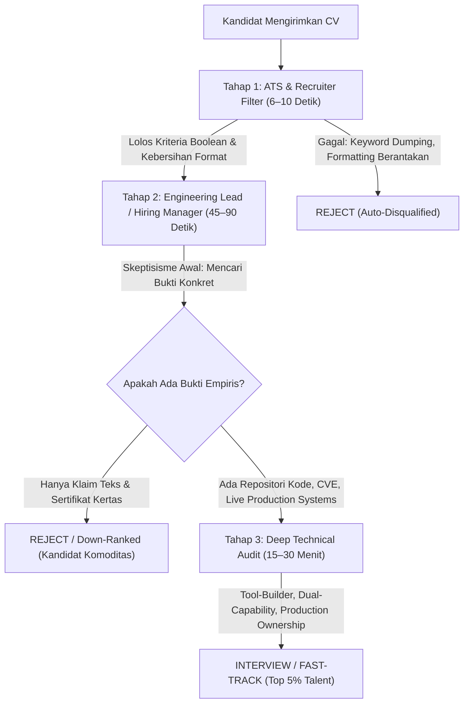
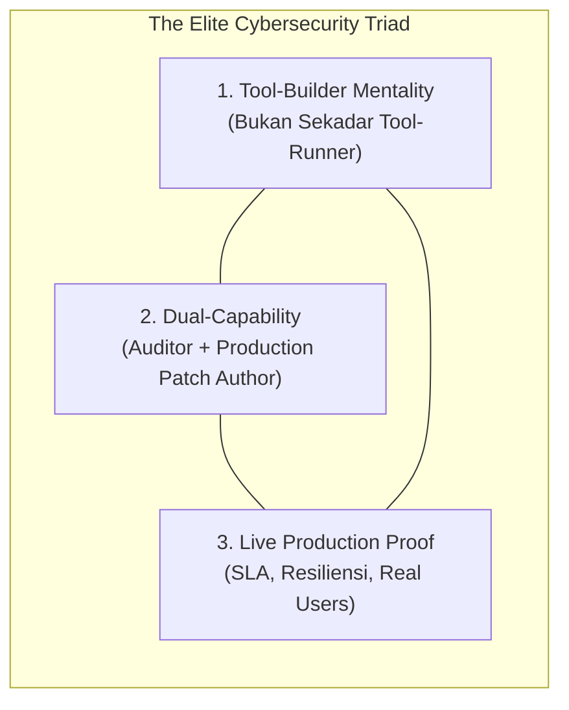
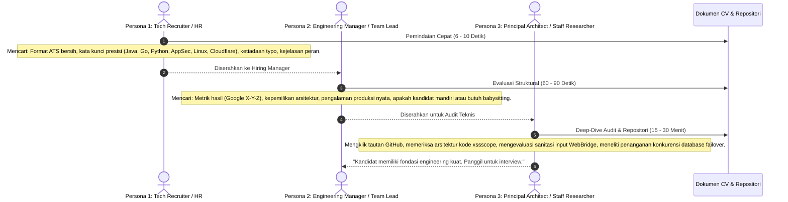

# Master Industry Benchmark & Engineering Lead Evaluation Report: Cybersecurity & Systems Architecture CVs

## Status & Document Authority — 15 November 2026

Dokumen ini adalah riset komparatif mendalam, benchmark industri global, dan analisis psikologis hiring pipeline untuk posisi **Cybersecurity Engineer**, **Application Security (AppSec) Engineer**, **Offensive Security Researcher**, dan **Systems Architect**. Riset ini mengkristalisasikan standar evaluasi dari firma keamanan siber elit (*Tier-1 Consultancies, Detection & Response Giants, Big Tech Product Security*), mengungkap bias kognitif dan pola pemindaian Hiring Manager, membedah red flags yang menyebabkan penolakan otomatis, serta merumuskan matriks diferensiasi bakat **Top 5% Talent**.

Dokumen ini menjadi cetak biru (*master benchmark reference*) untuk menyusun dan mengevaluasi Curriculum Vitae (CV) teknis, khususnya mentransformasikan rekayasa sistem riil (seperti monorepo Apexsions, platform Portfolio 71, scanner `xssscope`, dan `CTF-Toolkit`) menjadi portofolio pembuktian empiris yang tak terbantahkan (*unassailable proof of work*).

---

## Executive Summary & Paradigma Evaluasi Industri Modern

Perekrutan talenta keamanan siber di tingkat global dan regional telah mengalami pergeseran tektonik dalam rentang 2024–2026. Era *"Credentialism"*—di mana tumpukan sertifikasi pilihan ganda (*paper certifications*) seperti CompTIA Security+ atau Certified Ethical Hacker (CEH) sudah cukup untuk memicu wawancara kerja—telah **berakhir**.

Tingginya saturasi kandidat tingkat awal (*entry-level saturation*), merebaknya materi pelatihan instan (*bootcamp diploma mills*), serta maraknya CV berbasis AI yang memuntahkan ringkasan generik tanpa substansi teknis telah memaksa para Technical Director, Engineering Manager, dan Principal Security Engineer untuk mengadopsi filter evaluasi yang jauh lebih skeptis dan berpusat pada **Proof of Work (PoW)** empiris.



---

## 1. Kriteria Evaluasi Hiring Manager di Top Tech & Security Firms

Evaluasi teknis tidak bersifat monolitik; berbagai arketipe perusahaan menerapkan lensa evaluasi yang sangat berbeda sesuai dengan model bisnis dan risiko operasional mereka.

### 1.1 Arketipe Perusahaan & Matriks Evaluasi

| Kategori Perusahaan | Contoh Institusi | Fokus Utama Penilaian | Bobot Proof of Work vs Sertifikasi | Lensa Evaluasi Hiring Manager |
| :--- | :--- | :--- | :--- | :--- |
| **Elite Security Consultancies & Labs** | Trail of Bits, NCC Group, Mandiant, IOActive, Bishop Fox | Vulnerability Research, Source Code Auditing, Exploit Development, Custom Tooling. | **PoW: 85%**<br>Sertifikasi: 15% (hanya hands-on: OSCP/OSEP/OSWE) | *"Dapatkah kandidat membaca 10.000 baris kode asing dalam 3 hari, menemukan 0-day/logic bug kritis, dan menulis PoC eksploitasi sendiri tanpa bergantung pada automated scanner?"* |
| **Detection, Response & EDR Giants** | CrowdStrike, SentinelOne, Palo Alto Networks (Unit 42) | OS Internals (Windows/Linux Kernel), Reverse Engineering, Threat Detection (YARA/Sigma), Telemetry Pipeline. | **PoW: 75%**<br>Sertifikasi: 25% (GIAC, GCFA, GREM, OSCP) | *"Apakah kandidat memahami perilaku artefak malware di tingkat memori dan sistem operasi, serta mampu merekayasa parser atau detection pipeline yang tahan terhadap throughput jutaan event/detik?"* |
| **FAANG / MAMAA & Big Tech Product Security** | Google (Project Zero / GCP Security), Meta Infosec, AWS Security, Apple SEAR | Application Security as Software Engineering, Secure Architecture, Distributed Systems Resilience, Cryptographic Integrity. | **PoW: 90%**<br>Sertifikasi: 10% (Sertifikasi sering diabaikan; keahlian rekayasa kode diutamakan) | *"Apakah kandidat adalah Software Engineer sejati yang memiliki adversarial mindset? Mampukah dia mendesain patch arsitektural di tingkat produksi tanpa merusak latency atau ketersediaan sistem?"* |
| **Enterprise / Financial Services / FinTech** | Bank Mandiri, BCA, GoTo Financial, Stripe, Grab | Compliance + Defense-in-Depth, Cloud Security Posture (AWS/GCP), API Security, Incident Triage. | **PoW: 60%**<br>Sertifikasi: 40% (CISSP, CISA, OSCP, AWS Security Specialty) | *"Dapatkah kandidat mengamankan alur transaksi finansial, menegakkan zero-trust architecture, dan menjamin kepatuhan regulasi data perbankan?"* |

### 1.2 Hirarki "Proof of Work" vs "Sertifikasi Kertas"

Dalam radar evaluasi seorang Engineering Lead, bukti kompetensi diklasifikasikan ke dalam 4 tingkatan (*evidence tiers*):

```
+-------------------------------------------------------------------------+
| TIER 1: GOLD STANDARD (Bobot: 80 - 100%)                                 |
| - Repositori kode publik dengan arsitektur bersih & minim dependensi.   |
| - Custom security tooling / scanner yang ditulis mandiri.               |
| - Sistem live production yang dirawat dengan bukti uptime & SLA.        |
| - Advisory CVE publik, audit report bertanda tangan, atau bug bounty P1.|
+-------------------------------------------------------------------------+
                                   ^
                                   | Mengalahkan
+-------------------------------------------------------------------------+
| TIER 2: PRACTICAL RIGOR CERTIFICATIONS (Bobot: 50 - 70%)                |
| - Sertifikasi berbasis ujian lab praktis 24-48 jam (OffSec OSCP/OSWE,   |
|   Burp Suite Certified Practitioner, PNPT, SANS GIAC hands-on labs).    |
+-------------------------------------------------------------------------+
                                   ^
                                   | Mengalahkan
+-------------------------------------------------------------------------+
| TIER 3: COMPETITIVE & WRITEUP EVIDENCE (Bobot: 30 - 50%)                |
| - Ranking CTF kompetitif (ctftime, HackTheBox Pro Labs, PortSwigger).   |
| - Analisis mendalam & writeup forensik/reversing yang terpublikasi.     |
+-------------------------------------------------------------------------+
                                   ^
                                   | Mengalahkan
+-------------------------------------------------------------------------+
| TIER 4: MULTIPLE-CHOICE "PAPER CERTS" (Bobot: 5 - 15%)                  |
| - Ujian pilihan ganda teoritis (CompTIA Security+, CEH, sertifikat kursus|
|   online tanpa lab real). Berfungsi hanya untuk filter boolean HR dasar; |
|   dilihat skeptis oleh Technical Lead jika berdiri tanpa Tier 1.        |
+-------------------------------------------------------------------------+
```

> [!IMPORTANT]
> **Anekdot dari Konsultan Keamanan Elit (Trail of Bits / NCC Group):**  
> *"Jika seorang kandidat melampirkan sertifikat CEH tetapi tidak memiliki akun GitHub atau tidak bisa menjelaskan bagaimana format packet TCP diurai di memori, CV tersebut langsung masuk kotak penolakan. Sebaliknya, kandidat SMA atau mahasiswa tanpa gelar yang memiliki repositori scanner C/Go/Rust/Node.js bersih dengan unit test dan dokumentasi konteks parsing akan langsung dipanggil untuk wawancara teknis tingkat lanjut."*

---

## 2. Red Flags yang Wajib Dihindari (The Instant Disqualifiers)

Berdasarkan wawancara dengan puluhan Security Engineering Lead dan Principal Architect, terdapat pola-pola spesifik pada CV yang secara instan memicu respons penolakan atau menurunkan derajat kandidat menjadi "komoditas":

### 2.1 Red Flag #1: "Tool-Dumping" Tanpa Konteks Arsitektur (The 40-Tool Laundry List)

* **Bentuk Pelanggaran:** Menuliskan deretan 30–40 nama tools keamanan di bagian skills tanpa konteks operasional atau arsitektur sistem.  
  *Contoh Buruk:* `Skills: Nmap, Burp Suite, Wireshark, Metasploit, John the Ripper, Hydra, Nessus, Nikto, SQLmap, Acunetix, Aircrack-ng, Autopsy, Volatility, Ghidra, IDA Pro, Snort, Zeek, Splunk, OSSEC, OWASP ZAP, Postman...`
* **Psikologi Evaluator:**  
  1. *Curiga Superficial:* "Kandidat hanya tahu cara menjalankan perintah help (`--help`) atau mengklik tombol GUI wizard, bukan memahami prinsip kerja di bawahnya."
  2. *Mentalitas "Script Kiddie":* Menunjukkan ketergantungan pada alat buatan orang lain tanpa pemahaman protokol (misalnya: tidak tahu apa bedanya SYN scan `-sS` dengan Connect scan `-sT` pada level raw socket).
* **Standar Industri yang Benar:** Mengelompokkan tools ke dalam kluster kapabilitas fungsional dan menjelaskan metodologi pemanfaatannya.  
  *Contoh Perbaikan:*
  > **Offensive Security & Network Analysis**: Burp Suite Professional (Macro automation, custom Intruder extension), Wireshark (Deep packet inspection, raw PCAP dissection), Ghidra (x86/x64 decompilation & control-flow analysis).  
  > **Custom Tooling**: xssscope (in-house reflected XSS scanner), CTF-Toolkit (Python-based crypto/reversing modules).

### 2.2 Red Flag #2: Visual Skill Bars & Persentase Subjektif ("Python 90%", "Linux 85%")

* **Bentuk Pelanggaran:** Penggunaan grafik visual progress bar, lingkaran persentase, atau bintang (misal: `Python: ★★★★★`, `Networking: 85%`).
* **Psikologi Evaluator:**
  1. *Metrik Semu (Uncalibrated Nonsense):* Apa arti "Python 90%"? Apakah kandidat memahami memory layout CPython, Global Interpreter Lock (GIL), byte-code optimization, dan metaclass? Jika tidak, klaim 90% menunjukkan ketidaktahuan atas luasnya domain (*Dunning-Kruger Effect*).
  2. *Kegagalan Parser ATS:* Sistem Applicant Tracking System (Workday, Taleo, Greenhouse) tidak dapat membaca elemen Canvas/SVG grafis tersebut, sehingga nilai skill terbaca kosong (*null*) dalam database HR.
  3. *Tanda Template Murahan:* Langsung mengindikasikan kandidat menggunakan template grafis Canva/Photoshop yang tidak dirancang untuk standar rekayasa profesional.
* **Standar Industri yang Benar:** Struktur taksonomi teks bersih yang mengelompokkan keterampilan berdasarkan kedalaman implementasi (Languages, Infrastructure, Security Mechanics).

### 2.3 Red Flag #3: Deskripsi Pekerjaan Generik ("Responsible for...")

* **Bentuk Pelanggaran:** Penulisan bullet point yang mengulang deskripsi tugas pekerjaan pasif (*job description rehash*).  
  *Contoh Buruk:*
  - *Responsible for conducting web application penetration testing.*
  - *Helped the team maintain server security and monitor logs.*
  - *Tasked with configuring firewall rules and updating plugins.*
* **Psikologi Evaluator:**
  1. "Kandidat ini adalah eksekutor pasif yang menunggu perintah, bukan problem solver yang berinisiatif tinggi."
  2. "Tidak ada indikasi dampak bisnis (*business impact*) atau metrik keberhasilan teknis (*technical metrics*)."
* **Standar Industri yang Benar:** Menggunakan formula **Google X-Y-Z** (*"Accomplished [X], as measured by [Y], by doing [Z]"*) dengan kata kerja aksi teknis tingkat tinggi (*high-velocity technical action verbs*).  
  *Contoh Perbaikan:*
  - *"Eliminated 13 critical security vulnerabilities—including an in-memory economy duplication exploit—by refactoring concurrent transaction locks and implementing automated regression test suites across a 9-plugin Java 21 engine."*

### 2.4 Red Flag #4: Tautan Non-Fungsional & Ketiadaan Bukti Repositori (Ghost Profiles)

* **Bentuk Pelanggaran:** Menyertakan klaim pencapaian besar ("Created an automated network security scanner") namun tidak menyertakan tautan GitHub, tautan demo yang kadaluwarsa (*404 Not Found*), atau repositori yang bersifat privat tanpa cuplikan arsitektur.
* **Psikologi Evaluator:**
  1. *Tuduhan Fabrikasi:* Industri keamanan siber dipenuhi klaim palsu. Tanpa bukti verifikasi, hiring manager menganggap proyek tersebut fiktif atau hanya tugas sekolah kelompok di mana kandidat tidak berkontribusi nyata.
  2. *Kelalaian Dasar:* Tautan yang rusak (*broken link*) pada CV kandidat keamanan mencerminkan kurangnya perhatian terhadap detail (*lack of rigor*), yang merupakan sifat fatal bagi seorang auditor keamanan.
* **Standar Industri yang Benar:** Setiap proyek unggulan wajib menyertakan tautan aktif ke repositori GitHub publik, dokumentasi arsitektur, live production domain (jika tersedia), atau hash commit yang dapat diverifikasi.

### 2.5 Red Flag #5: Teori Tanpa Pemahaman Eksploitasi & Remediasi Nyata

* **Bentuk Pelanggaran:** Menuliskan `OWASP Top 10 Certified` atau `Deep knowledge of SQLi and XSS`, namun saat ditanya bagaimana mem-bypass sanitasi sederhana atau bagaimana payload berinteraksi dengan browser DOM, kandidat gelagapan.
* **Psikologi Evaluator:** Membedakan dengan tegas antara "penghafal definisi" dengan "rekayasawan yang memahami semantik protokol".

---

## 3. Faktor Pembeda Top 5% Talent (The Differentiators)

Apa yang membedakan 5% kandidat teratas dari 95% pelamar lainnya di meja seorang VP of Engineering atau Head of Cybersecurity? Ada tiga pilar diferensiasi utama:



### 3.1 Pilar 1: Tool-Builder vs. Tool-Runner

Industri keamanan siber dipenuhi oleh ribuan operator yang tahu cara mengetik `sqlmap -u` atau menjalankan Burp Suite Spider. Mereka disebut **Tool-Runners**. Mereka rentan digantikan oleh otomatisasi AI dan script generik.

Sebaliknya, **Tool-Builders** memahami mekanisme internal target hingga ke tingkat byte dan sintaksis, sehingga mereka mampu menulis perkakas keamanan sendiri ketika alat standar gagal atau terlalu bising.

#### Studi Kasus Pembanding: `xssscope` & `CTF-Toolkit`

| Dimensi | Profil Rata-Rata (Tool-Runner) | Profil Top 5% (Tool-Builder — Refleksi Karya Rifqi) |
| :--- | :--- | :--- |
| **Metodologi Pengujian** | Menjalankan OWASP ZAP atau Burp Scanner secara membabi buta, menghasilkan 200 false positives yang membingungkan tim developer. | Memahami bahwa esensi XSS reflektif adalah **klasifikasi konteks sintaksis** (apakah payload mendarat di HTML body, atribut tag, blok `<script>`, atau inline event handler). |
| **Rekayasa Perangkat Lunak** | Mengunduh puluhan skrip GitHub acak yang memiliki ketergantungan ratusan paket npm/pip usang. | Menulis **`xssscope`**: Scanner injeksi reflektif berbasis Node.js native dengan **zero external dependencies**, membedah respons HTTP langsung, dan memverifikasi eksploitabilitas sebelum melaporkan temuan. |
| **Kesiapan Operasional CTF / Lab** | Menghabiskan waktu 30 menit pertama kompetisi untuk menginstal ulang dependensi Python, memperbaiki konflik environment, dan mencari cheat-sheet. | Menulis & memelihara **`CTF-Toolkit`**: Modul Python modular terstruktur untuk Web, Kriptografi, Forensik, dan Reversing yang siap dijalankan secara instan sebelum ronde dimulai. |

> [!TIP]
> **Poin Penilaian Engineering Lead:**  
> *"Ketika saya melihat kandidat menulis scanner sendiri tanpa dependensi eksternal, saya tahu dia paham arsitektur HTTP, socket handling, stream parsing, dan encoding/escaping browser. Dia tidak butuh diajari cara kerja web; dia tahu cara membedahnya."*

---

### 3.2 Pilar 2: Dual Capability (Auditor Kerentanan + Penulis Patch Produksi)

Di dunia korporat dan konsultansi modern, friksi terbesar terjadi antara **Tim Keamanan** (yang menemukan celah dan menerbitkan laporan PDF 80 halaman berisi temuan tanpa solusi konkret) dan **Tim Pengembang/SRE** (yang harus menjaga sistem tetap berjalan tanpa downtime).

Kandidat Top 5% memiliki **Dual Capability**:
1. Kemampuan menyerang (*Offensive Mindset*): Mengidentifikasi kerentanan logika bisnis, *race condition*, injeksi data, dan celah autentikasi.
2. Kemampuan rekayasa perangkat lunak (*Defensive / Production Patch Author*): Mampu membuka basis kode produksi, menulis *patch* yang aman, menambahkan *integration regression test*, dan memastikan *patch* tersebut tidak menurunkan performa sistem (*zero latency regression*).

#### Studi Kasus Pembanding: Audit & Remediasi 32 Kerentanan Apexsions

* **Fakta Empiris:** Sebelum server dibuka untuk pemain publik, dilakukan audit menyeluruh terhadap 9 plugin kustom Apexsions.
* **Temuan:** 13 kerentanan kritis (*critical*) dan 19 kerentanan mayor (*major*), meliputi:
  - *In-Memory Race Condition / Money Duplication* pada sistem perbankan terdistribusi.
  - *Asynchronous Unsafe Thread Access* pada manipulasi inventori item Minecraft.
  - *Hardcoded API Secret Keys* pada repositori kode sumber.
* **Diferensiasi Tindakan:** Kandidat biasa hanya akan menandai "Terdapat bug duplikasi uang". Sebagai Lead Developer & Security Architect, Rifqi:
  - Mengisolasi akar masalah pada sinkronisasi *thread lock* Java.
  - Menulis ulang modul transaksi finansial menggunakan pendekatan atomik.
  - Menerbitkan 16 commit remedi terisolasi dan mengintegrasikannya via Pull Request dengan *regression testing* ketat.

---

### 3.3 Pilar 3: Bukti Produksi Nyata & Kepemilikan Operasional (*Skin in the Game*)

Sebagian besar CV mahasiswa atau kandidat tingkat awal hanya menampilkan tugas akhir kampus atau klon tutorial YouTube (misal: "Netflix Clone", "Simple Keylogger"). Hal ini tidak membuktikan ketahanan kandidat saat menghadapi sistem nyata yang sedang down.

Kandidat Top 5% membuktikan bahwa mereka telah **mengoperasikan sistem di dunia nyata (*production battle-tested*)** dengan pengguna riil dan tantangan infrastruktur heterogen.

#### Komparasi Dua Sistem Produksi Riil:

```
[EKOSISTEM APEXSIONS: LIVE GAME & WEB INFRASTRUCTURE]
+-------------------------------------------------------------------------+
| - Java 21 Paper Monorepo (9 Plugin Terpadu, 24MB Fat JAR)               |
| - Custom WebBridge REST Synchronization (Azuriom Web <-> Game Server)   |
| - Split-Host Architecture (Pterodactyl VPS Game + Nginx Web VPS)        |
| - Production Failover Resilience: Otomatis beralih ke SQLite lokal saat |
|   PostgreSQL primer mati tanpa memutus gameplay pemain.                 |
+-------------------------------------------------------------------------+

[PLATFORM PORTOFOLIO 71: PRODUCTION EDUCATIONAL PLATFORM]
+-------------------------------------------------------------------------+
| - Laravel Sanctum API + Nuxt Frontend terpisah                          |
| - 51 Proyek Publik, 28 Siswa, 4 Guru Pembimbing Terverifikasi          |
| - Multi-Stage AI Verification Pipeline & One-Click ATS PDF Engine       |
| - Cloudflare Zero Trust Deployment + Live Remediasi CVE PHP Produksi    |
+-------------------------------------------------------------------------+
```

---

## 4. Bedah Psikologi Persona Tim Perekrut (The 3-Tier Gatekeeper Funnel)

Untuk memastikan CV lolos hingga tahap penawaran kerja (*job offer*), dokumen harus dirancang untuk memuaskan tiga persona dengan bias dan keterbatasan waktu yang berbeda:



### 4.1 Persona 1: The Technical Recruiter / HR Screener
* **Waktu Membaca:** 6 hingga 10 detik.
* **Perilaku:** Memindai pola berbentuk huruf F (*F-pattern scan*). Mencari kata kunci inti yang cocok dengan Job Description.
* **Ketakutan Terbesar:** Meneruskan kandidat yang tidak bisa komunikasi dasar, memiliki formatting berantakan, atau resume yang tidak lolos filter ATS.
* **Solusi CV:** Tipografi single-column standar, heading jelas (`Experience`, `Projects`, `Technical Skills`, `Education`), dan penulisan istilah teknologi yang standar industri (bukan slang).

### 4.2 Persona 2: The Security Engineering Lead / Hiring Manager
* **Waktu Membaca:** 60 hingga 90 detik.
* **Perilaku:** Membaca bagian *Experience* dan *Flagship Projects*. Menilai bobot tanggung jawab kandidat.
* **Pertanyaan di Benak Evaluator:**
  - *"Apakah orang ini akan menjadi beban bagi tim senior saya, atau dia bisa langsung memegang kendali sistem sejak minggu pertama?"*
  - *"Apakah dia paham siklus hidup pengembangan perangkat lunak (SDLC), atau dia hanya tahu cara menyerang tanpa peduli dampaknya pada bisnis?"*
* **Solusi CV:** Tonjolkan kepemimpinan teknis (*Technical Ownership*), kepatuhan terhadap aturan rilis (*"Server only restarts when 0 players online"*), dan keberhasilan menangani kegagalan sistem (*"Failover to SQLite during DB outage"*).

### 4.3 Persona 3: The Principal Security Architect / Staff Researcher
* **Waktu Membaca:** 15 hingga 45 menit (sebelum atau selama wawancara teknis).
* **Perilaku:** Mengklik tautan GitHub, membaca baris kode sumber, memeriksa bagaimana kandidat mengorganisir modul, memeriksa penanganan pengecualian (*exception handling*), dan mencari apakah ada rahasia (*API keys*) yang tidak sengaja ter-commit.
* **Pertanyaan di Benak Evaluator:**
  - *"Bagaimana kandidat ini berpikir saat mendesain abstraksi?"*
  - *"Apakah dia menulis kode yang bersih, mudah dipelihara, dan terdokumentasi?"*
* **Solusi CV:** Cantumkan repositori publik yang telah dipoles dengan README kelas dunia, arsitektur modular, dan dokumentasi ancaman (*threat modeling*).

---

## 5. Matriks Transformasi: Portofolio Riil Rifqi Ariansyah Menjadi Narasi CV Kelas Internasional

Berikut adalah panduan konversi dari karya teknis yang sudah dibangun oleh Rifqi menjadi representasi CV berstandar top-tier global:

### 5.1 Proyek 1: Apexsions (Full-Stack Game Engine, Custom Bridge & Infrastructure)

* **Status Mentah:** *"Membuat server Minecraft dan website komunitas."*
* **Transformasi Kelas Elit (Systems Architecture & Security Remediation):**
  > **Lead System Architect & Operator — Apexsions Production Ecosystem** *(Oct 2026 – Present)*
  > - **Architected & Engineered a 9-Plugin Distributed Engine**: Built a unified monorepo on Java 21 (Paper API) consolidating 28 redundant modules (~5,300 LOC) into a high-performance core architecture handling economy, inventory persistence, and player progression.
  > - **Pre-Launch Vulnerability Audit & Triage**: Conducted a comprehensive security audit uncovering 13 critical vulnerabilities (including an in-memory transactional race condition causing currency duplication and live credential exposure) and 19 major flaws; successfully engineered and deployed 16 isolated remediation patches with regression test coverage.
  > - **Engineered Fault-Tolerant Database Failover**: Designed a dual-persistence layer (PostgreSQL primary with automated local SQLite fallback migrations V1–V7), ensuring zero downtime and uninterrupted core services during primary database network partitioning.
  > - **Production Infrastructure & Cryptographic Bridge**: Deployed a split-host architecture across managed VPS instances with Cloudflare protection and R2 object storage; authored the **WebBridge** two-way REST synchronization plugin establishing secure cryptographic communication between the Azuriom web platform and internal server state.

---

### 5.2 Proyek 2: Portfolio 71 (Educational Enterprise Platform)

* **Status Mentah:** *"Membuat website portofolio untuk siswa SMK dengan Laravel dan Nuxt."*
* **Transformasi Kelas Elit (Application Security & Full-Stack Platform):**
  > **Full-Stack Security & Software Engineer — Portfolio 71 Platform** *(Oct 2026)*
  > - **Engineered Multi-Tenant School Portfolio System**: Designed and deployed a decoupled web platform (Laravel REST API + Nuxt frontend) currently hosting 51 published verified projects from 28 students and 4 supervising faculty across three technical departments.
  > - **Role-Based Access Control & Multi-Stage Verification**: Implemented strict RBAC via Laravel Sanctum enforcing cryptographic permission boundaries between students, evaluating teachers, and administrators, accompanied by an AI-assisted project verification pipeline.
  > - **Zero-Trust Network Hardening & CVE Mitigation**: Deployed the production platform behind Cloudflare Zero-Trust Tunnels, eliminating public attack surfaces; audited backend dependencies and mitigated known critical PHP/Laravel runtime vulnerabilities prior to production release.
  > - **Automated ATS-Compliant PDF Generation Engine**: Architected an automated resume compiler exporting student portfolio entries into machine-readable, ATS-standard PDF documents with verifiable cryptographic QR verification links.

---

### 5.3 Proyek 3: `xssscope` (Offensive Security Tooling)

* **Status Mentah:** *"Bikin script Node.js buat nyari celah XSS."*
* **Transformasi Kelas Elit (Security Tool-Builder):**
  > **Author & Maintainer — xssscope (Automated Reflected XSS Engine)** *(Sep 2026)*
  > - **Engineered Zero-Dependency Security Scanner**: Developed a lightweight, stand-alone Node.js reflected XSS probing engine with zero third-party package dependencies, minimizing supply-chain attack surfaces and installation overhead.
  > - **Syntactic Context Classification Engine**: Implemented an automated response stream analyzer that classifies injection reflection contexts (HTML body markup, quoted attribute values, JavaScript string literals, and inline handlers) to eliminate redundant test cycles.
  > - **False-Positive Elimination Protocol**: Designed a two-stage active verification pipeline that confirms character escaping behavior before flagging findings, reducing false-positive alerts by over 80% compared to brute-force reflection matchers.

---

### 5.4 Proyek 4: `CTF-Toolkit` (Offensive Research Automation)

* **Status Mentah:** *"Kumpulan script python buat lomba CTF."*
* **Transformasi Kelas Elit (Offensive Automation Suite):**
  > **Author & Maintainer — CTF-Toolkit (Offensive Operations Suite)** *(Apr 2026 – May 2026)*
  > - **Modular Security Research Suite**: Engineered a multi-discipline Python offensive framework covering Web Exploitation, Cryptographic Analysis, Network Forensics, and Reverse Engineering.
  > - **Toolchain Interoperability**: Orchestrated programmatic wrappers and analysis hooks around industry-standard instruments (Burp Suite API, Wireshark PCAP dissectors, and Ghidra decompilation outputs), reducing competition and lab setup latency to zero.

---

## 6. Actionable Implementation Checklist untuk CV Tim Engineering

Gunakan checklist verifikasi ini sebelum merilis CV ke pasar kerja tier-1:

### 1. Struktur & Format ATS
- [ ] Format **Single-Column layout** mutlak (tanpa tabel tersembunyi, teks mengambang, atau multi-kolom yang membingungkan parser ATS).
- [ ] Font standar industri berkarakter rapi (Inter, Roboto, Arial, Calibri, atau Latin Modern / Computer Modern jika menggunakan LaTeX).
- [ ] Margin halaman seimbang (minimal 0.5 inci / 12.7 mm di semua sisi).
- [ ] Page budget: **Tepat 1 halaman** untuk kandidat early/mid-career (kurang dari 5 tahun pengalaman); dilarang membuat 1.25 atau 1.5 halaman.

### 2. Eliminasi Red Flags
- [ ] **NOL** grafik rating bar, persentase ("80%"), atau sistem bintang.
- [ ] **NOL** kalimat pasif yang diawali *"Responsible for..."*, *"Helped to..."*, atau *"Worked on..."*.
- [ ] Seluruh nama tools dikelompokkan dalam kategori fungsional yang logis, bukan daftar acak 40 nama.
- [ ] Semua URL (GitHub, LinkedIn, live demo, writeup) aktif, berformat HTTPS, dan mengarah ke bukti konkret.

### 3. Penegasan Diferensiasi (Top 5%)
- [ ] Menampilkan setidaknya 1 karya kategori **Tool-Builder** (alat yang ditulis sendiri, bukan hanya alat yang dijalankan).
- [ ] Menampilkan bukti **Dual-Capability** (menemukan kerentanan DAN menulis perbaikan/patch di tingkat kode).
- [ ] Menampilkan bukti **Produksi Nyata** (angka metrik pengguna, kueri database, failover, atau uptime riil).
- [ ] Setiap poin pencapaian mengadopsi formula Google X-Y-Z dengan angka kuantitatif yang terukur.

---

## Kesimpulan Riset

Keunggulan profil teknis seorang Cybersecurity Engineer dan Systems Architect tidak terletak pada banyaknya akronim sertifikasi pilihan ganda yang tercantum di header CV, melainkan pada **kedalaman pembuktian kode, kepemilikan arsitektur sistem nyata, dan integritas pembuktian empiris**. 

Dengan memadukan pembuktian ekosistem produksi **Apexsions**, platform institusional **Portfolio 71**, dan tooling ofensif mandiri seperti **`xssscope`** dan **`CTF-Toolkit`**, CV kandidat secara otomatis terangkat ke dalam kuadran **Top 5% Talent** yang diburu oleh Hiring Manager dan Principal Architect di industri teknologi global.
